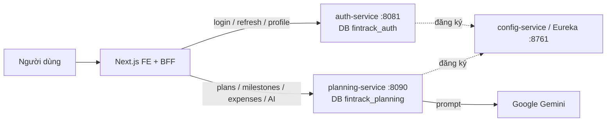
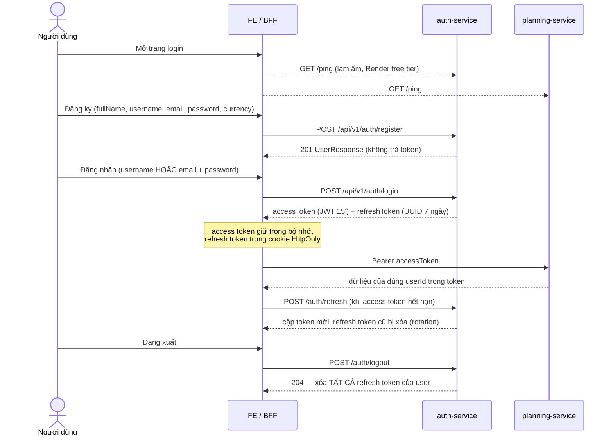
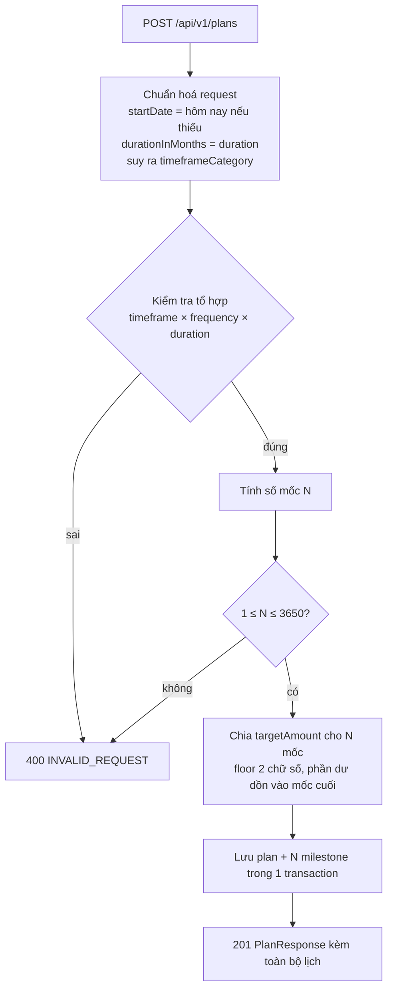
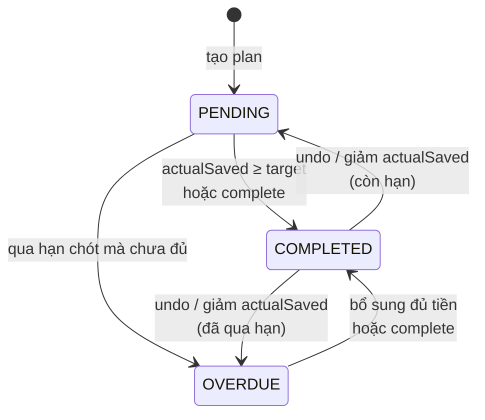
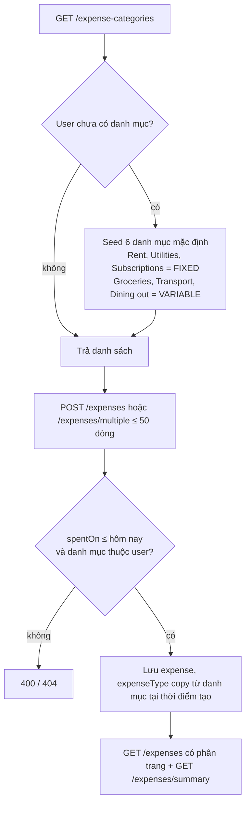

# FinTrack — Business Flow

> Tài liệu này mô tả **luồng nghiệp vụ end-to-end** của FinTrack, từ góc nhìn người dùng xuống tới từng service.
> Các file `docs/BUSINESS_LOGIC.md` trong từng repo vẫn là nơi ghi *quy tắc chi tiết*; file này trả lời câu hỏi
> "người dùng làm gì, hệ thống phản ứng ra sao, theo thứ tự nào".
>
> Ký hiệu: ⚠️ = chỗ code hiện tại **còn lệch** với flow mong muốn (xem mục 10). Cập nhật lần cuối: 2026-11-08
> (sau đợt sửa trên branch `fix/savings-progress-review` và `fix/auth-review-findings`).

---

## 0. Mục tiêu sản phẩm

FinTrack giúp người dùng **để dành đủ một số tiền cho một mục tiêu cụ thể (mua nhà, mua xe, du lịch…) trong một
khoảng thời gian định trước**. Hệ thống chia mục tiêu lớn thành các mốc nhỏ (milestone) theo ngày / tháng / năm,
theo dõi người dùng đã để dành được bao nhiêu ở mỗi mốc, và cho thấy họ đang đi đúng tiến độ hay chậm.
Phần quản lý chi tiêu và AI lập ngân sách là tính năng hỗ trợ: giúp người dùng hiểu tiền đi đâu để có tiền mà để dành.

---

## 1. Bản đồ hệ thống



| Service | Sở hữu dữ liệu | Vai trò |
|---|---|---|
| `auth-service` | `users`, `user_roles`, `accounts`, `refresh_tokens` | Đăng ký, đăng nhập, phát JWT, hồ sơ & tiền tệ ưa thích |
| `planning-service` | `plans`, `milestones`, `expenses`, `expense_categories` | Toàn bộ nghiệp vụ tiết kiệm & chi tiêu |
| `core` (thư viện) | — | `BaseEntity`, `ApiResponse`, `ErrorCode`, `GlobalExceptionHandler` |
| `config-service` | — | Eureka registry |

- Trình duyệt **không** gọi thẳng backend; mọi request đi qua BFF của Next.js.
- `planning-service` không gọi `auth-service`. Nó chỉ **xác thực chữ ký JWT** bằng secret dùng chung
  (`FINTRACK_JWT_SECRET`) và lấy `userId` từ claim. `userId` trong planning là "soft link", không có FK xuyên DB.

---

## 2. Flow định danh: Đăng ký → Đăng nhập → Refresh → Đăng xuất



Quy tắc:

1. **Đăng ký**: username 3–30 ký tự `[a-zA-Z0-9_]`, email hợp lệ, mật khẩu ≥ 8 ký tự và có ≥ 1 chữ số; mật khẩu băm BCrypt.
   Username/email trùng → `409`. Email được trim + lowercase trước khi lưu và luôn so sánh không phân biệt hoa thường.
   User mới nhận `ROLE_USER`; không có đường nào tự cấp `ROLE_ADMIN`.
2. **Đăng nhập**: tra theo username trước, không thấy thì tra theo email (không phân biệt hoa thường). Sai thông tin → `INVALID_CREDENTIALS`
   (không phân biệt "sai user" hay "sai mật khẩu"). User bị soft-delete không đăng nhập được.
3. **Refresh**: token phải tồn tại và chưa hết hạn; mỗi lần refresh token cũ bị xóa và phát token mới.
   User đã bị xóa/khoá → token bị xóa và trả `INVALID_TOKEN`, nên phiên của tài khoản đã xóa chết sau tối đa 15 phút.
4. **Đăng xuất**: thu hồi mọi phiên (mọi refresh token). Access token đã phát vẫn sống tới khi hết 15 phút.
5. **Dọn token**: job 02:00 hằng ngày xóa refresh token hết hạn (so sánh theo `Instant`, UTC).
6. ⚠️ Chưa có giới hạn số lần đăng nhập sai (rate limit đã mất khi bỏ gateway).
7. **Hồ sơ**: `PUT /users/profile` ghi đè toàn bộ (tên, email, tiền tệ); `PATCH /users/currency` chỉ đổi tiền tệ.
   Đổi email phải kiểm tra trùng (không phân biệt hoa thường) vì email cũng là định danh đăng nhập.

---

## 3. Flow chính: Tạo mục tiêu tiết kiệm (Plan)

### 3.1 Người dùng nhập

| Trường | Bắt buộc | Ghi chú |
|---|---|---|
| `goalTitle` (`title`) | ✔ | ≤ 50 ký tự |
| `targetAmount` | ✔ | > 0, lưu `NUMERIC(19,2)` |
| `currency` | ✔ | `VND` \| `USD` |
| `planCategory` | | 8 loại (nhà, xe, du lịch, khẩn cấp…) |
| `duration` / `durationInMonths` | ✔* | số tháng (FE gửi `duration`) |
| `frequency` | ✔ | `DAILY` \| `MONTHLY` \| `ANNUALLY` |
| `requiredPerPeriod` (`savingsPerPeriod`) | ✔ | số tiền FE tính sẵn để hiển thị |
| `startDate` | | mặc định hôm nay |

### 3.2 Hệ thống xử lý



**Bảng tổ hợp hợp lệ**

| Timeframe | Thời lượng | Tần suất cho phép |
|---|---|---|
| `SHORT_TERM` | 3–11 tháng | `DAILY`, `MONTHLY` |
| `MID_TERM` | 12–60 tháng | `DAILY`, `MONTHLY` |
| `LONG_TERM` | 61–240 tháng | `MONTHLY`, `ANNUALLY` |

Thời lượng được kiểm tra theo đúng khoảng của timeframe kể cả khi client tự gửi `timeframeCategory`
(`SHORT_TERM` + 200 tháng → `400`); `duration`/`durationInMonths` tối đa 240.

**Số mốc N**: `DAILY` = số ngày từ `startDate` tới `startDate + durationInMonths`; `MONTHLY` = số tháng;
`ANNUALLY` = `durationInYears` nếu có, không thì `ceil(tháng / 12)`.

**Mốc thời gian của từng milestone**

| Tần suất | Nhãn | Hạn chót |
|---|---|---|
| `DAILY` | `Day N` | chính ngày đó |
| `MONTHLY` | `November 2026` | ngày cuối tháng dương lịch |
| `ANNUALLY` | `Year N (2026)` | 31/12 năm đó |

⚠️ Mốc đầu tiên của `MONTHLY`/`ANNUALLY` là **tháng/năm dương lịch chứa `startDate`**. Bắt đầu ngày 25/11
thì mốc 1 chỉ còn 6 ngày để góp đủ 1 phần tháng; bắt đầu tháng 11 với `ANNUALLY` thì mốc "năm 1" chỉ còn ~7 tuần.

**Ví dụ**: mục tiêu 10.000.000 VND, 3 tháng, `MONTHLY`, bắt đầu 01/12/2026
→ 3 mốc: Tháng 12/2026 = 3.333.333,33 · Tháng 1/2027 = 3.333.333,33 · Tháng 2/2027 = 3.333.333,34.

---

## 4. Flow ghi nhận tiến độ (Milestone)

Người dùng có 3 thao tác trên một milestone:

| Thao tác | Endpoint | Hiệu ứng mong muốn |
|---|---|---|
| Nhập số đã để dành | `PATCH /plans/{id}/milestones/{mid}` `{actualSaved}` | Ghi đè `actualSaved` (≥ 0) |
| Đánh dấu hoàn thành | `POST …/complete` | `manuallyCompleted = true`; nếu `actualSaved` < target hiện tại thì nâng lên bằng target |
| Hoàn tác | `POST …/undo` | Bỏ đánh dấu **và trả lại số tiền trước khi complete**; trạng thái quay về theo số tiền thực tế |

### 4.1 Vòng đời trạng thái (tính **live** mỗi lần đọc, không tin cột `status` trong DB)



Thứ tự ưu tiên: `COMPLETED` > `OVERDUE` > `PENDING`.

Chi tiết:
- `complete` nhớ số tiền cũ vào `actualSavedBeforeCompletion` trước khi nâng lên target; gọi `complete` lần 2 không làm gì.
- `undo` khôi phục số tiền đã nhớ. Nếu giữa chừng người dùng tự `PATCH` số tiền thì con số họ nhập được giữ, `undo` chỉ bỏ cờ.
- Milestone được complete **trước** đợt sửa này không có số tiền cũ để khôi phục → `undo` vẫn chỉ bỏ cờ.

---

## 5. Flow trễ hạn & phân bổ lại (Deficit redistribution)

Mỗi plan có công tắc `recalculateOnMissedDeadline` (mặc định **tắt**), đổi qua `PATCH /plans/{id}/settings`.

- **Tắt**: lịch giữ nguyên; mốc trễ cứ OVERDUE, không ảnh hưởng mốc khác.
- **Bật**: mỗi lần đọc plan, các mốc còn mở (PENDING) phải góp
  `targetAmount − tổng tiền đã góp ở các mốc đã đóng (OVERDUE/COMPLETED)`, chia đều (floor 2 chữ số,
  phần dư cent dồn vào mốc cuối). Không còn mốc mở nào thì không chia.
  - Mốc trễ thiếu tiền → các mốc sau tăng lên.
  - Góp **dư** ở mốc trước → các mốc sau **giảm** xuống (tối thiểu 0).
  - Mốc được complete thủ công nhưng thiếu tiền → phần thiếu vẫn chuyển cho các mốc mở.

**Bất biến mong muốn**: `tổng tiền người dùng phải góp` luôn bằng `targetAmount`, không hơn không kém.

Ví dụ (mục tiêu 300, 3 mốc × 100, mốc 1 trễ hạn với 0 đồng):

| | Mốc 1 | Mốc 2 | Mốc 3 | Tổng phải góp |
|---|---|---|---|---|
| Sau khi phân bổ | 100 (OVERDUE) | 150 | 150 | 300 ✔ |
| Sau khi complete mốc 2 (150) | 100 (OVERDUE) | 150 ✔ | 150 | 300 ✔ |
| Nếu mốc 1 góp dư 160 thay vì 0 | 160 ✔ | 70 | 70 | 300 ✔ |

(Code cũ cho mốc 3 lên 200, tổng 350. Đã có test hồi quy `computeLiveMilestones_completingAReceiverDoesNotOverCollect`.)

---

## 6. Flow xem tiến độ

| Màn hình | Endpoint | Nội dung |
|---|---|---|
| Danh sách mục tiêu | `GET /api/v1/plans` | Mỗi plan: `totalSaved`, `remaining`, `progressPercent` |
| Chi tiết mục tiêu | `GET /api/v1/plans/{id}` | Như trên + toàn bộ milestone với target/trạng thái live |
| Dashboard | `GET /api/v1/plans/summary` | Gộp theo **từng loại tiền** (không bao giờ cộng VND với USD): số plan, số plan xong, tổng target, tổng đã để dành, còn lại |

Công thức:

```
totalSaved      = Σ actualSaved của TẤT CẢ milestone (tiền góp một phần cũng tính)
remaining       = max(0, targetAmount − totalSaved)
progressPercent = min(100, totalSaved / targetAmount × 100), làm tròn 2 chữ số
```

Ví dụ: góp 90 + 100 + 110 = 300/300 → **100%**, còn lại 0 (code cũ báo 70%). Dashboard dùng cùng công thức trong SQL,
và một plan được tính là "đã xong" khi tổng đã góp ≥ target.

---

## 7. Flow chi tiêu (Expense)



- Tạo danh mục riêng: trùng tên (không phân biệt hoa thường) → `409 DUPLICATE_CATEGORY_NAME`.
- Bulk: kiểm tra **mọi dòng trước**, có dòng lỗi thì không lưu dòng nào và trả về toàn bộ lỗi.
- Đổi `defaultType` của danh mục **không** đổi các expense cũ; muốn đổi thì `PATCH` từng expense.
- Lọc: `from`+`to` (đủ cả hai hoặc không có gì = toàn thời gian), `type`, `categoryId`. List và summary dùng chung
  một mệnh đề WHERE nên không bao giờ lệch nhau. Summary chia theo từng loại tiền; `fixed + variable = total`.
- Xóa expense = **xóa hẳn** khỏi DB.
- `currency` chỉ nhận `VND`/`USD` (không phân biệt hoa thường khi gửi lên), lưu dạng chữ hoa.
- List phân trang tối đa 100 dòng/trang.
- ⚠️ `planId` trên expense được nhận ở request nhưng **không có cột lưu**; liên kết chi tiêu ↔ mục tiêu chưa tồn tại.

---

## 8. Flow AI lập ngân sách

`POST /api/v1/plans/ai/generate` `{prompt}` → gửi prompt kèm system prompt tới Gemini (`gemini-2.0-flash`).
Người dùng không nêu tỷ lệ thì áp dụng quy tắc 50/30/20 (thiết yếu / mong muốn / tiết kiệm-đầu tư).
Kết quả là JSON `{totalBudget, currency, term, categories[], aiAdvice}`; **không lưu DB**, chỉ là gợi ý.
Prompt tối đa 2000 ký tự. Lỗi từ AI → `SERVICE_UNAVAILABLE` với thông báo thân thiện.
⚠️ Chưa có rate limit, trong khi mỗi lần gọi Gemini đều tốn tiền.

---

## 9. Quy tắc xuyên suốt

| Chủ đề | Quy tắc |
|---|---|
| Tiền | Luôn `BigDecimal` / `NUMERIC(19,2)` (kể cả DTO của AI); trả ra JSON dạng string ở các endpoint summary để JS không mất độ chính xác |
| Tiền tệ | Không bao giờ cộng gộp khác loại tiền. Plan và expense gắn tiền tệ riêng, không quy đổi |
| Múi giờ | "Hôm nay" là ngày theo `Asia/Ho_Chi_Minh` (bean `Clock` trong `ClockConfig`), không theo giờ máy chủ (Render = UTC) |
| Đa người dùng | Mọi truy vấn lọc theo `userId` lấy từ JWT, không bao giờ từ request body. Tài nguyên không phải của mình trả về `404` y hệt "không tồn tại" (lọc ngay trong câu query) |
| Xóa | **Xóa hẳn** cho cả plan (kèm milestone) và expense. Các dòng đã soft-delete từ trước vẫn nằm trong DB nên mọi query đọc vẫn lọc `is_deleted = false` |
| Bất biến tài chính | Tổng target của các milestone = `targetAmount`; tổng phải góp sau phân bổ = `targetAmount` |

---

## 10. Trạng thái các lỗi đã review & việc còn mở

| # | Flow | Vấn đề | Trạng thái |
|---|---|---|---|
| B1 | §5 | Phân bổ lại thu thừa tiền | ✅ Đã sửa |
| B2 | §4 | `undo` không có tác dụng | ✅ Đã sửa (milestone complete trước đợt sửa: undo chỉ bỏ cờ) |
| B3 | §6 | Tiến độ bỏ qua tiền góp một phần | ✅ Đã sửa (cả plan card lẫn dashboard SQL) |
| B4 | §9 | "Hôm nay" theo UTC | ✅ Đã sửa (`Clock` Asia/Ho_Chi_Minh) |
| B5 | §2 | User mới nhận `ROLE_ADMIN` | ✅ Đã sửa |
| B6 | §2 | User bị xóa vẫn refresh được | ✅ Đã sửa |
| B8 | §3 | Không kiểm tra thời lượng theo timeframe | ✅ Đã sửa |
| B10 | §7 | Currency expense là chuỗi tự do | ✅ Đã sửa |
| B11 | §9 | `FORBIDDEN` để lộ ID nào tồn tại | ✅ Đã sửa (plan, expense) |
| B12 | §2 | Job dọn token truyền sai kiểu | ✅ Đã sửa |
| B14 | §2 | Email phân biệt hoa thường | ✅ Đã sửa (chưa có rate limit đăng nhập) |
| — | §6 | N+1 ở danh sách plan | ✅ Đã sửa (1 query cho mọi milestone) |
| B7 | §3 | Mốc đầu tiên bị ngắn (tháng/năm dương lịch) | ⏳ Chưa sửa: đổi nhãn/kỳ hạn, cần thống nhất với FE |
| B9 | §7 | `planId` của expense bị bỏ qua | ⏳ Chưa sửa: cần thêm cột + migration nếu muốn dùng |
| B13 | §7 | Seed danh mục mặc định bị race khi 2 request đầu tiên song song | ⏳ Chưa sửa |
| — | §2, §8 | Rate limit đăng nhập & AI | ⏳ Chưa có |

**Câu hỏi nghiệp vụ còn mở:**

1. Mốc đầu tiên của lịch tháng/năm: bắt đầu từ `startDate` hay theo lịch dương (B7)?
2. Có cho phép **sửa mục tiêu giữa chừng** (đổi số tiền, gia hạn) không? Hiện chưa có endpoint; nếu có thì phải
   sinh lại lịch cho phần chưa tới hạn (công thức phân bổ mới đã sẵn sàng cho việc này vì dựa trên tổng base target).
3. Có cần **lịch sử giao dịch bất biến** (mỗi lần góp/rút là một dòng) thay vì ghi đè `actualSaved` không?
